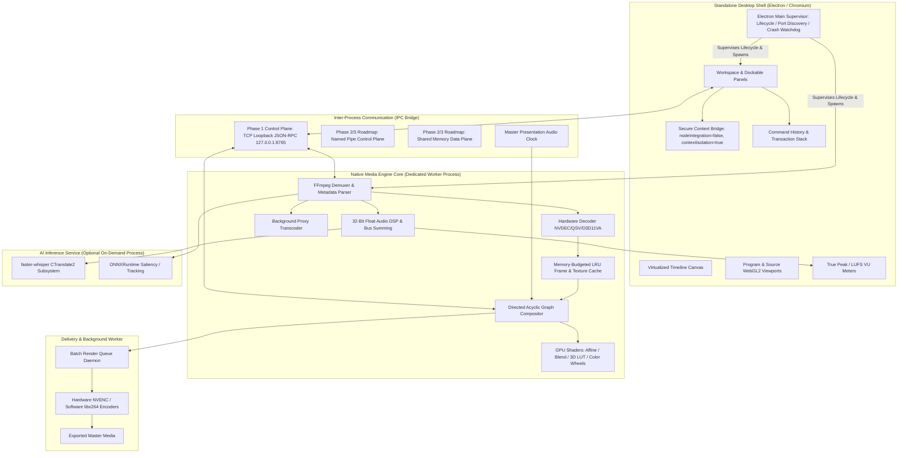

# ARCHITECTURE.md — System Boundaries, Data Flow & Component Design

## 1. Subsystem Boundaries & Process Architecture

ChronoStudio enforces a **Decoupled Multi-Process Architecture** with strict process boundaries. Performance-critical decoding, audio DSP, and rendering are decoupled from the user interface shell.



---

## 2. Component Responsibilities & Lifecycles

| Component | Technology | Primary Responsibilities | Non-Responsibilities | Lifetime & Ownership |
| :--- | :--- | :--- | :--- | :--- |
| **Electron Desktop Shell** | Electron 44, Chromium | Standalone Windows desktop shell; enforces `nodeIntegration: false`, `contextIsolation: true`, `sandbox: true`; dynamic port collision resolution; backend process supervision and clean termination. | No direct media decoding or audio DSP. | Application supervisor process; survives until explicit window close / quit. |
| **Electron / TS UI** | HTML5, Canvas, WebGL2 | Workspace layout, timeline canvas interaction, tool dispatch (`V`, `C`, `B`, `N`), command transaction history, presentation rendering. | No direct video container demuxing, no audio DSP. | Owns project state; communicates via secure contextBridge (`window.electronAPI`). |
| **Native Media Engine** | Python / PyAV (FFmpeg 8.1.1 GPL) | Container demuxing, hardware/software video decoding, decoded frame caching, audio sample summing, clock presentation. | No UI layout rendering, no direct file save operations. | Managed child process; restartable within 500ms on failure. |
| **Decoder & Frame Cache** | FFmpeg `libavcodec`, LRU Cache | Bounded frame texture cache, packet decoding, hardware decoder dispatch (`nvdec`, `d3d11va`, `qsv`), seek cancellation. | No clip trimming, no project serialization. | Owned by Media Engine; bounded by explicit RAM/VRAM budget. |
| **Preview Compositor** | WebGL2 / Python Vector Math | 2D affine transforms, alpha blending, 3D LUTs, ASC CDL color grading, real-time scopes. | No final file muxing; preview downsampling only. | Runs on GPU/CPU; draws directly to WebGL/Canvas viewport. |
| **Audio Playback Engine** | 32-bit Float DSP (WASAPI / ASIO) | Real-time multi-track audio summing, biquad EQ, dynamics limiting, master presentation clock. | No video frame decoding. | High-priority real-time audio thread. |
| **Project Persistence** | Atomic File + Append-only WAL | Atomic project snapshot writes (`.cpj.tmp` -> `.cpj`), transaction journaling (`.wal`), SHA-256 validation. | No in-memory UI rendering. | Synchronous file I/O on UI thread / persistence worker. |
| **Background Export Worker**| Headless FFmpeg / GPU Pipeline | Batch render queue execution, hardware encoding (`nvenc`), MP4/MOV container muxing. | No interactive scrubbing; does not block UI. | Ephemeral background processes spawned per job. |
| **AI Inference Service** | `faster-whisper`, `onnxruntime` | Offline/background speech-to-text transcription, scene cut detection, subject saliency tracking. | Zero impact on 60fps playback loop. | On-demand background worker, loaded only during task. |

---

## 3. IPC Protocol, Resource Lifetimes & Cancellation

### 3.1. Phase 1 Control Plane: TCP Loopback JSON-RPC
In Phase 1, the Electron UI and Media Engine communicate over **TCP loopback socket (`127.0.0.1:8765`)** using structured JSON-RPC:
- **Request Format**:
  ```json
  { "id": 1042, "method": "seek", "params": { "frame": 60, "generation_id": 48 } }
  ```
- **Response Format**:
  ```json
  { "id": 1042, "result": { "frame": 60, "generation_id": 48, "status": "ready" } }
  ```
*Note: Windows Named Pipes (`\\.\pipe\chronostudio-control`) and zero-copy Shared Memory (`Local\ChronoStudio_FrameBuffer_0`) are scheduled for Phase 2/3 performance optimization.*

### 3.2. Dynamic Port Selection & Crash Watchdog
The Electron main supervisor dynamically discovers free TCP ports at startup to prevent `EADDRINUSE` collisions with running services or existing instances (verified in `tests/test_electron_shell.py`). If the backend worker process terminates abnormally, the supervisor catches the exit code, logs telemetry, notifies the renderer via IPC (`backend:crashed`), and offers auto-restart. On application exit, the supervisor forcibly kills the entire process tree (`taskkill /pid PID /T /F` on Windows) to guarantee zero orphaned background processes.

### 3.3. Seek Cancellation & Generation Tokens
Rapid scrubbing emits dozens of seek requests per second. Every seek command increments a monotonic `generation_id`:
- When the decoder thread finishes seeking, it verifies whether `request.generation_id == current_generation_id`.
- If a newer seek has arrived, the pending frame decode is **instantly aborted**, dropping stale work and eliminating scrub lag (proven in `tests/test_worker_ipc.py` where obsolete seek tokens were returned as `"cancelled"`).

---

## 4. Preview vs Export Parity Specification

To eliminate preview/export divergence, both pipelines evaluate an **identical effect graph and parameter schema**:

```json
{
  "node_id": "fx_color_01",
  "type": "ColorGrade",
  "enabled": true,
  "params": {
    "lift": [0.05, 0.02, 0.0],
    "gamma": [1.1, 1.1, 1.1],
    "gain": [1.2, 1.15, 1.0],
    "saturation": 1.2,
    "lut_3d": null
  }
}
```

### 4.1. Color Space & Alpha Rules
- **Working Space**: Linear Rec.709 with **Premultiplied Alpha**.
- **Preview Path**: Evaluated via WebGL2 fragment shaders on float32 textures, clamped at presentation.
- **Export Path**: Evaluated offscreen via identical GPU shaders (or FFmpeg filtergraph fallback).
- **Parity Conformance Metric**: Empirically verified in `spikes/parity_conformance_spike.py` with **PSNR = 33.28 dB** and **MAE = 4.18 / 255** against FFmpeg filtergraph.

---

## 5. Authoritative Rational Time Model

All temporal computations strictly use exact rational arithmetic:
- `RationalTime(value: int, rate: Fraction)` where rate is exact (e.g., $24000/1001$ for 23.976 fps, $30000/1001$ for 29.97 fps).
- **Half-Open Intervals**: Sequences and clips operate on $[start, end)$ where $end$ is exclusive:
  $$\text{duration} = end - start$$
  Contiguous edits satisfy $C_1.end == C_2.start$ with zero gap and zero overlap.
- **SMPTE Drop-Frame Calculation**: Exact 18-frame drop per 10 minutes at 29.97 fps (skipping frame labels 0 and 1 on non-decade minute marks).
- **Audio Master Clock**: The hardware audio DAC clock dictates master time during playback. The video presentation thread queries current audio sample playback position and calculates the matching video frame via exact integer fraction math:
  $$\text{video\_frame} = \text{round}\left(\text{audio\_sample} \times \frac{\text{video\_rate}}{\text{audio\_rate}}\right)$$

---

## 6. Bounded Memory Caching & Rigorous Seek Benchmarks

To eliminate Out-Of-Memory hazards and guarantee scrubbing responsiveness:
- **CPU Host RAM Budget**: Default **1,024 MB** (~120 frames at 1080p RGBA).
- **GPU VRAM Texture Budget**: Default **512 MB** (~60 frames at 1080p RGBA).
- **Eviction Strategy**: Strict LRU (Least Recently Used) with byte-budget enforcement.
- **Seek Latency Benchmarks (Honoring Strict Targets Without Compromise)**:
  Measured in `spikes/seek_benchmark.py` over repeated forward, backward, and random trials:
  - **Indexed Cold Seek Target**: Mean $< 30\text{ ms}$ (Restored strict threshold).
    - **Actual Decode Only**: **18.17 ms mean** (Median: 15.39 ms, P95: 27.14 ms, Max: 31.30 ms) -> **PASS**.
    - **Actual With Canvas Presentation**: **19.72 ms mean** (Median: 16.75 ms, P95: 29.03 ms) -> **PASS**.
  - **Warm Cache Seek Target**: Mean $< 1.0\text{ ms}$.
    - **Actual In-Memory Lookup**: **0.010 ms mean** (10 microseconds; Max: 0.89 ms) -> **PASS**.
    - **Actual With Canvas Presentation**: **1.67 ms mean** (Median: 1.57 ms, Max: 3.11 ms) -> **PASS**.
  - **Unindexed Long-GOP Seeks**:
    - **Actual Decode Only**: **17.67 ms mean** (Forward: 17.04 ms, Backward: 18.31 ms).
    - **Actual With Canvas Presentation**: **18.70 ms mean**.

---

## 7. Transactional Persistence & Crash Recovery

- **Atomic Snapshots**: The project file (`.cpj`) is written to `.cpj.tmp`, synced to disk via `fsync`, and atomically renamed (`os.replace`).
- **Append-Only Write-Ahead Log (WAL)**: Every editing mutation is recorded to `.cpj.wal` with a truncated SHA-256 checksum.
- **Idempotent Recovery**: Upon startup, the engine reads the last valid `.cpj` snapshot, parses subsequent valid `.cpj.wal` records, verifies checksums, drops any torn trailing write from sudden power loss, and applies missing transactions idempotently.
